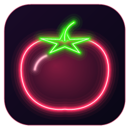
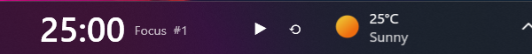

<p align="center">
  
</p>

<h1 align="center">Tmatmaia</h1>

<p align="center">A Pomodoro timer that lives <b>inside</b> the Windows 11 taskbar.</p>

<p align="center">
  
</p>

## The story 🍅

**Tmatmaia** (طماطماية) means "one tomato" in Egyptian Arabic 😂

I turned the internet upside down looking for a Pomodoro app that sits right inside the Windows taskbar, with a big, clear timer. Nothing did it the way I wanted. So I decided to build the version I'd actually use, vibe-coding it with Claude. It came out looking pretty good, so I'm sharing it with everyone as open source.

<div dir="rtl">

**طماطماية**  😂

قلبت الدنيا على النت بدوّر على برنامج بومودورو يتثبّت في الـ taskbar، ويكون التايمر فيه كبير وواضح، وملقتش حاجة على مزاجي. فقررت أعمل النسخة اللي أنا عايزها لاستخدامي، بالـ vibe coding مع Claude. ولما خلص وطلع شكله حلو، قلت أشاركه مع الكل على GitHub كـ open source.

</div>

## Features

- Sits in the empty part of the taskbar, so it never covers windows and stays visible.
- Focus, short break and long break phases, with a long break every N pomodoros.
- Start/pause and reset buttons right on the taskbar, plus a progress bar under the timer.
- Click the time to start or pause; **double-click it to open Settings**.
- Sound and a Windows notification when a phase ends.
- Optional start with Windows.
- Tray icon with the same controls (Start/Pause, Reset, Skip, Settings, Exit).
- Follows the Windows light/dark theme.

## Requirements

- Windows 11 (the taskbar embedding uses Windows 11 internals).
- To **run** a release: nothing else, since releases bundle the .NET runtime.
- To **build** from source: the [.NET 10 SDK](https://dotnet.microsoft.com/download/dotnet/10.0).

## Install

1. Download `Tmatmaia-<version>-setup.exe` from the [Releases page](https://github.com/Salah-Elsayed404/tmatmaia/releases).
2. Run it. No admin rights or .NET needed; it installs to `%LOCALAPPDATA%\Programs\Tmatmaia`.
3. On the last page, tick **Start Tmatmaia when Windows starts** if you want it to launch automatically. You can change this later: double-click the timer and toggle **Start with Windows**.
4. The timer appears in the taskbar after a couple of seconds.

Uninstall from Windows Settings → Apps like any other program.

The app is not code-signed yet, so Windows may warn or block it:
- **SmartScreen:** choose **More info → Run anyway**.
- **Smart App Control** (if turned on) blocks unsigned downloads outright, with no override. Build it from source (below) instead, or turn Smart App Control off.

## Build from source

```powershell
git clone https://github.com/Salah-Elsayed404/tmatmaia.git
cd tmatmaia
dotnet build
```

Run it while developing:

```powershell
dotnet run --project src/Tmatmaia
```

Build the installer into `dist/`:

```powershell
./scripts/publish.ps1
```

This needs [Inno Setup 6](https://jrsoftware.org/isinfo.php) (`winget install JRSoftware.InnoSetup`). Without it, or with `-SkipInstaller`, the script only produces the self-contained app in `dist/Tmatmaia/`, which you can run directly.

You can also open `Tmatmaia.slnx` in Visual Studio 2026 or JetBrains Rider.

## Project layout

```
src/Tmatmaia/
  App.xaml(.cs)              Startup, single instance, tray icon, window lifetime
  Core/PomodoroEngine.cs     Timer state machine, no UI code
  Core/Settings.cs           Settings model, saved as JSON
  Views/MainWindow.xaml      Host window that gets embedded in the taskbar
  Views/TaskbarWidget.xaml   What you see in the taskbar
  Views/SettingsWindow.xaml  The settings dialog
  Services/Notifier.cs       Sound and notification when a phase ends
  Services/StartupRegistration.cs   "Start with Windows" (HKCU Run key)
  Assets/tmatmaia.ico        App icon (generated by scripts/make-icon.ps1)
installer/
  Tmatmaia.iss               Inno Setup script for the installer
scripts/
  publish.ps1                Builds the installer
  make-icon.ps1              Draws the neon tomato icon from code
docs/
  DESIGN.md                  Design decisions and known limitations
```

Settings are stored in `%APPDATA%\Tmatmaia\settings.json`.

## How the taskbar embedding works

Windows 11 removed the old DeskBand API. Tmatmaia uses [Deskband11Lib](https://github.com/airtaxi/Deskband11Lib), which reparents a transparent WPF window into the taskbar (`Shell_TrayWnd`) and uses UI Automation to find free space. The app rebuilds its window when Explorer restarts or the DPI changes.

This relies on undocumented shell behavior, so a Windows update can break it. If that happens, switch **Placement** to **Overlay** in Settings, which puts the timer in a regular always-on-top window over the taskbar instead.

## Known limitations

- Only the primary monitor's taskbar is supported.
- The taskbar must not be set to auto-hide.
- Overlay mode positions itself with a fixed offset from the right edge, which may need adjusting on unusual layouts.

## Contributing

Issues and pull requests are welcome. See [CONTRIBUTING.md](CONTRIBUTING.md).

## License

[MIT](LICENSE). Third-party components are listed in [THIRD-PARTY-NOTICES.md](THIRD-PARTY-NOTICES.md).
